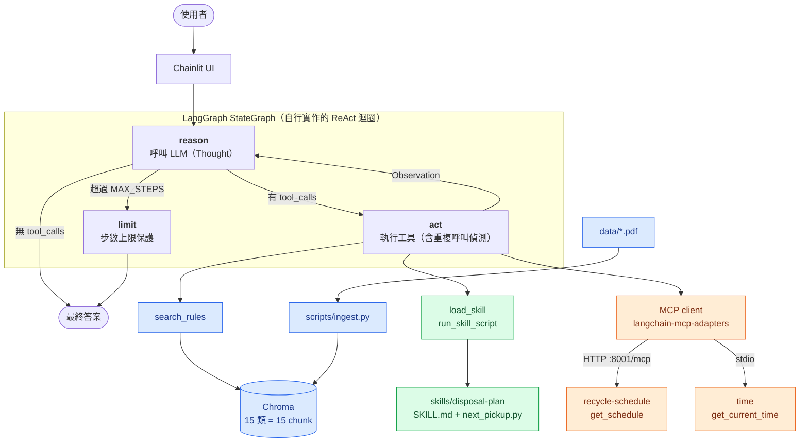

# 高雄市資源回收分類助理

本專案是查詢高雄市資源回收分類與收運時間的 AI Agent。以 LangGraph 自行實作 ReAct 迴圈，讓模型依「思考 → 行動 → 觀察」拆解問題，並平行呼叫工具。分類規則透過 RAG 取得：環保局回收分類表（15 類）以 OpenAI Embedding 存入 Chroma，查不到就回覆「查無資料」不臆測。收運時刻與目前時間透過 MCP 取得，下一個收運日則由 Skill 腳本確定性計算，不讓模型推算日期。使用者可在 Chainlit 即時看到每一步推理，最後取得包含複合材質拆解、注意事項與收運時段的丟棄計畫。

- 分類規則：高雄市環保局「回收分類表」（`data/kaohsiung_recycle_rules.pdf`，唯一來源）
- 收運時間：預設收運點時刻表（`mcp_recycle/schedule.json`）
- 每則訊息獨立處理，沒有對話記憶

註：本專案與 Claude Code 協作開發。

## 1. 架構



> 圖中藍色為 **RAG**、綠色為 **Skills**、橘色為 **MCP**。此圖為 Mermaid，GitHub 會自動渲染；VS Code 需安裝 Markdown Mermaid 擴充套件才看得到預覽。

| 元件 | 說明 |
| --- | --- |
| `agent/recycle_agent/graph.py` | `StateGraph`：`reason`、`act`、`limit` 三個節點。act 會攔下與上一輪或同輪相同的工具呼叫 |
| `agent/recycle_agent/rulebook.py` | 讀 PDF：每類一頁 = 一個 chunk |
| `agent/recycle_agent/tools/rag.py` | `search_rules`：Chroma cosine 檢索，低於門檻回傳「查無資料」 |
| `agent/recycle_agent/tools/skills.py` | `load_skill`、`run_skill_script`（只能執行 `skills/<name>/scripts/*.py`） |
| `agent/recycle_agent/tools/mcp_tools.py` | 連接 MCP server |
| `mcp_recycle/` | 自建 MCP server，`get_schedule()` 每次呼叫都重新讀檔 |
| `skills/disposal-plan/` | 丟棄計畫的操作說明與 `next_pickup.py`（日期一律由腳本計算） |
| `eval/` | 26 題評測 |

## 2. 本機執行

1. 安裝 [uv](https://docs.astral.sh/uv/)，在專案根目錄執行：
   ```powershell
   uv sync
   ```
2. 複製設定檔並填入 OPENAI_API_KEY 金鑰：
   ```powershell
   Copy-Item .env.example .env
   ```
3. 建立知識庫：
   ```powershell
   uv run scripts/ingest.py
   ```
4. 啟動（同時啟動時刻表 MCP 與 Chainlit，Ctrl+C 一起結束）：
   ```powershell
   uv run scripts/dev.py
   ```
5. 開啟 <http://localhost:8000>。

## 3. Docker執行

```bash
docker compose run --rm ingest     # 建立知識庫（寫入 chroma_data volume）
docker compose up -d               # 啟動 mcp-recycle 與 agent
```

## 4. 時刻表（`mcp_recycle/schedule.json`）

| 欄位 | 意義 |
| --- | --- |
| `area` | 收運點（目前固定為「預設收運點」，為保護隱私不公開） |
| `pickup_window` | 每個收運日的到站區間 `start`–`end`。目前是取整後的大致區間 |
| `weekly` | 每週各天（`mon`…`sun`）收運的類別，只有「一般垃圾」「資源回收」兩種 |
| `exceptions` | 特定日期的覆蓋規則 |
| `notes` | 給使用者的說明文字 |
| `source` | 資料來源名稱、查詢網址與整理日期 |

資料取自高雄市環保局開放資料「垃圾清運路線及時間」，整理日期 2026-10-23。目前寫死為一個預設收運點，時段為取整後的大致區間。使用者問其他地點時，Agent 會導向 <https://kepbgps.kcg.gov.tw/>。

**可依環保局公告新增 `exceptions`**（春節、颱風、國定假日等）：

```json
"exceptions": [
  {"date": "2027-02-06", "collect": [], "note": "春節停收"},
  {"date": "2026-11-04", "collect": ["資源回收"], "note": "公告改收資源回收"}
]
```

## 5. 知識庫

- `data/kaohsiung_recycle_rules.pdf` 是分類規則的唯一來源，不要修改或另外改寫分類內容。
- 更換 PDF 後：重新執行 ingest，**並重啟 agent**（執行中的 agent 不會讀到新索引）。
- 新 PDF 必須符合格式：第 1 頁封面，之後每類一頁，第一行是 `【類別 NN／TT】類別名稱`，文件資訊含 `/SourceName`、`/SourceURL`、`/Retrieved`。`uv run pytest tests/test_rulebook.py` 會檢查。
- 換 embedding 模型（`EMBED_MODEL`）會對應到新的 collection，需重跑 ingest。
- `RAG_SCORE_THRESHOLD` 是相似度門檻，調高更嚴格，調低更寬鬆。目前的預設值是 0.25，這是評測校準後的結果。

## 6. 專案介紹投影片
* [下載專案介紹投影片](https://drive.google.com/file/d/1TU2PVX6CeR2WDqzADjzEL3U5382Zl-r8/view?usp=sharing)

